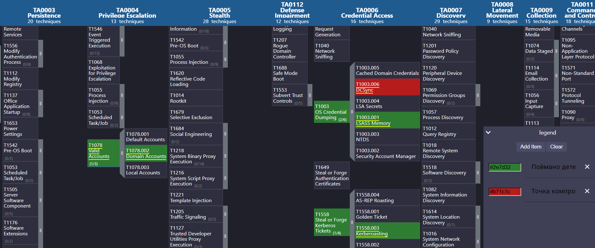

# SOC Detection Engineering: сквозная Kill Chain в Wazuh (zunami.lab)

> **End-to-end детект-инжиниринг:** 10-этапная цепочка атаки от password spraying до DCSync, проиграна на стенде Active Directory, поймана кастомными правилами Wazuh, собрана в таймлайн, карту MITRE ATT&CK и отчёт об инциденте.

Капстоун-проект по направлению **Blue Team / SOC-аналитик**. Демонстрирует полный цикл работы аналитика: от написания правил корреляции до расследования многоэтапного инцидента и IR-отчётности.

---

## Что демонстрирует проект

- **Детект-инжиниринг** — 10 кастомных правил Wazuh (`local_rules.xml`), привязка к реальным базовым правилам через `if_sid`, работа с полями eventchannel
- **Триаж по EventID** — разбор Windows Security / Sysmon событий с позиции аналитика (4624/4625/4662/4697/4728/4769/1102, Sysmon 1/10)
- **Корреляция** — восстановление сессий атакующего по `logonId`, привязка DCSync (без IP) к источнику через 4624
- **MITRE ATT&CK** — маппинг 10 техник на 6 тактик, тепловая карта покрытия (Navigator layer)
- **IR-отчётность** — отчёт об инциденте для двух аудиторий (executive + технический L2/IR) по NIST SP 800-61
- **Траблшутинг телеметрии** — методика «событие есть, а алерта нет» (аудит → доставка → декодер → правило)

---

## Схема стенда

```
┌──────────────┐      атака       ┌────────────────────┐
│     Kali     │ ───────────────► │      KSC-SRV       │
│   10.0.2.4   │                  │   DC zunami.lab    │
│ (атакующий)  │   impacket/nxc   │  Windows Server    │
└──────────────┘                  └─────────┬──────────┘
                                            │ агент Wazuh (eventchannel)
                                            ▼
                                  ┌────────────────────┐
                                  │   Wazuh Manager    │
                                  │     (Ubuntu)       │
                                  │  детект + SIEM     │
                                  └────────────────────┘
```

**Компоненты:** Wazuh 4.9.2 · Windows Server (DC, Sysmon) · Kali Linux (impacket, netexec, pypykatz)

---

## Kill Chain — 10 этапов

| # | Этап | Правило | Событие | Тактика → Техника |
|---|------|---------|---------|-------------------|
| 1 | Password spraying | 100300 | 4625 ×N | Credential Access → T1110.003 |
| 2 | Брутфорс → вход | 100100 + 100600 | 4625 → 4624 | Credential Access / Initial Access → T1110 + T1078 |
| 3 | Обфусцированный PowerShell | 100210 | Sysmon 1 | Execution → T1059.001 |
| 4 | Kerberoasting | 100400 | 4769 (RC4) | Credential Access → T1558.003 |
| 5 | Дамп LSASS | 100200 | Sysmon 10 | Credential Access → T1003.001 |
| 6 | Pass-the-Hash | 100600 | 4624 (NTLM t3) | Lateral Movement → T1550.002 |
| **7** | **DCSync (компрометация домена)** | **101000** | **4662** | **Credential Access → T1003.006** |
| 8 | Вредоносная служба | 100700 | 7045 | Persistence → T1543.003 |
| 9 | eviladmin → Domain Admins | 100900 | 4728 | Persistence / PrivEsc → T1098, T1078.002 |
| 10 | Очистка журнала | 100800 | 1102 | Defense Evasion → T1070.001 |

**Точка компрометации домена — этап 7 (DCSync + кража krbtgt).** Всё до неё — путь к цели, всё после — закрепление и сокрытие.

---

## Покрытие MITRE ATT&CK

6 тактик · 10 техник · 3 источника данных (Windows Security audit, Sysmon, System log).



> Интерактивный слой: `mitre/attack-navigator-layer.json` — загрузить на [ATT&CK Navigator](https://mitre-attack.github.io/attack-navigator/).

---

## Структура репозитория

```
├── README.md                      # этот файл
├── scenario.md                    # легенда и сценарий kill chain
├── rules/
│   └── local_rules.xml            # кастомные правила Wazuh 100100–101000
├── timeline.md                    # таймлайн инцидента
├── report.md                      # отчёт об инциденте (executive + L2/IR)
├── mitre/
│   ├── attack-navigator-layer.json
│   └── heatmap.png                # тепловая карта покрытия
├── evidence/                      # скриншоты-доказательства по этапам 1–10
├── playbooks/                     # плейбуки реагирования (PtH, DCSync, …)
└── cheatsheets/                   # шпаргалка Windows EventID
```

---

## Ключевые документы

- **[Отчёт об инциденте](report.md)** — полное расследование: executive summary, хронология, технический разбор, рекомендации
- **[Плейбуки реагирования](playbooks/)** — PtH, DCSync, траблшутинг детекта (NIST SP 800-61)
- **[Правила детекта](rules/local_rules.xml)** — исходники всех правил корреляции

---

## Условия

Все наступательные действия выполнены **исключительно на изолированном учебном стенде** (VirtualBox NatNetwork, без выхода в прод) для целей отработки обнаружения (Blue Team). Учётные данные и хеши — учебные, для реальных систем непригодны.

---

**Автор:** Богданов А. В.
